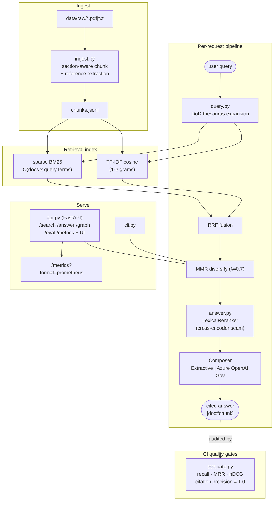

# PolicyScout

**Created and maintained by [Sergio Rodriguez (SSH-PuR66)](https://github.com/SSH-PuR66).**

**A retrieved passage has to earn its citation.** Trace a query through the retrieval pipeline, then inspect the [evaluation](eval/) and [critique log](docs/CRITIQUE.md). The measured ranking and citation results below describe the bundled 12-query / 6-document corpus.

GAMECHANGER is the stated design inspiration. The Azure Government document is a deployment plan, not a claim that this repository has an accredited deployment.

**GAMECHANGER-inspired semantic search over DoD policy documents.**

**v0.4** — hybrid sparse-BM25+TF-IDF retrieval with RRF fusion, DoD-domain query expansion (cyber-ops thesaurus), MMR diversification, cited extractive QA with a **cross-encoder-shaped reranker** (citation precision 0.94 → **1.00**), a grounded-LLM composer seam, nDCG + citation-precision eval gates over a **12-query / 6-document** set, `/metrics` with **Prometheus export**, and a built-in web UI at `/`.

Inspired by the [CDAO Analytic Tools initiative](https://www.ai.mil/Initiatives/Analytic-Tools/) —
specifically GAMECHANGER's NLP-powered policy search — PolicyScout is a small, reproducible
pipeline that ingests publicly released DoD issuances, chunks and indexes them, and serves
semantic search through a REST API and CLI.

Built exclusively with tooling from the
[Expert-Driven Development approved tools list](https://jeranaias.github.io/ExpertDrivenDevelopment/tools/):
open-source on public GitHub (unclassified), with a pluggable embedding backend wired for
**Azure OpenAI (FedRAMP High)** and a deployment plan for **Azure Government at IL5**
(see [docs/IL5_DEPLOYMENT.md](docs/IL5_DEPLOYMENT.md)).

## Architecture



Text fallback (renders anywhere Mermaid doesn't):

```
raw docs ─► ingest (section chunk + refs) ─► chunks.jsonl
                                               │
              ┌──────── TF-IDF cosine ◄────────┤
 query ─► expand (thesaurus)                    ├─► BM25 (sparse)
              └──► RRF fusion ─► MMR ─► reranker ─► composer ─► cited answer
                                               │
                         cli.py            api.py (FastAPI + /metrics→Prometheus)
                                               │
                            evaluate.py: recall / MRR / nDCG / citation-precision (CI-gated)
```

- **Default backend is fully offline** (TF-IDF): deterministic, reproducible, no data
  leaves the environment — the correct default posture for CUI-adjacent workflows.
- **`AzureEmbeddingBackend`** swaps in with one config change for production-quality
  semantic embeddings inside an authorized Azure Government boundary.

## Quickstart

```bash
pip install -e ".[dev]"

# Optional: pull real public DoD issuances (DoDD 3000.09, DoDI 5000.89,
# DoDI 5200.48, DoD Data/Analytics/AI Adoption Strategy)
python scripts/fetch_corpus.py

# Build the index (works out of the box on the bundled sample corpus)
python -m policy_scout.cli index

# Search from the CLI
python -m policy_scout.cli search "impact level 5 controlled unclassified information"

# Or run the API
uvicorn policy_scout.api:app --app-dir src
curl "localhost:8000/search?q=responsible+AI+principles"
```

## Testing & CI

`pytest` covers the full pipeline end-to-end (ingest → index → search → API), and
GitHub Actions runs lint (ruff) + tests on Python 3.10 and 3.12 for every push/PR.

```bash
pytest -v
```

## Corpus note

The repo ships with clearly labeled **synthetic sample documents** so the pipeline and
tests run anywhere with zero network access. `scripts/fetch_corpus.py` replaces them
with real, publicly released issuances from esd.whs.mil / media.defense.gov.

## Why this project exists

Built to demonstrate the specialized-experience competencies for a Forward Deployed
Engineer role (USAJOBS 2210/GS-14): technology integration (data pipelines + AI/ML),
end-to-end software engineering, and modern CI/CD — mapped onto the CDAO analytic
tools ecosystem (GAMECHANGER, Advana, JATIC).
